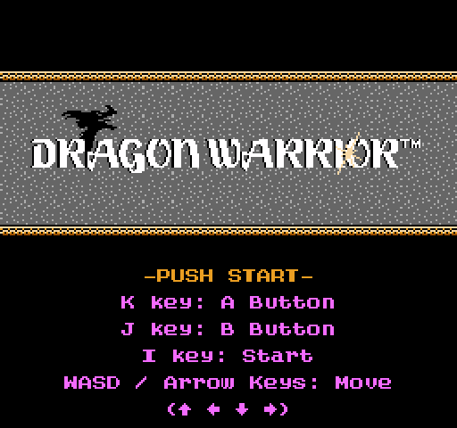
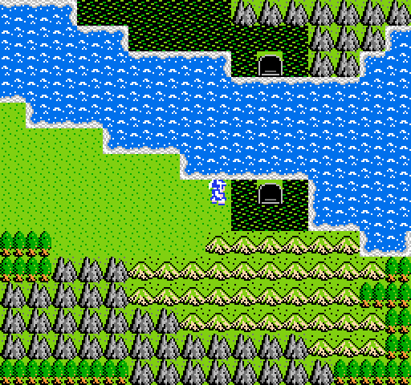
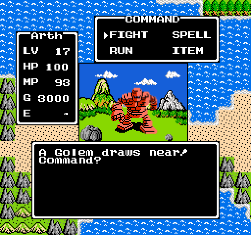
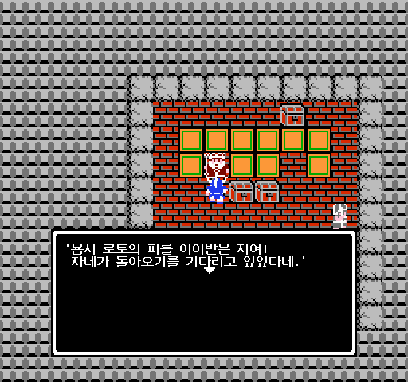

# Dragon Warrior

A faithful remake of *Dragon Warrior* for the NES, written in Python with [pygame](https://www.pygame.org/). The goal
is to play exactly like the NES game: the maps, the formulas, the enemies and the messages are checked against a
disassembly of the original. On top of that come optional modern conveniences, such as save states, a faster game
speed, a quest journal and a message log. Each one has its NES behaviour as one of its values, each can be switched on
or off on its own, and the ones that are on from the start only do something when you press their key. Choose the NES
preset in the options for the NES game and nothing else.

It plays in English or in Korean.

| | |
| --- | --- |
|  |  |
|  |  |

This is an unofficial fan project, not affiliated with or endorsed by Square Enix or Nintendo. See
[About](#about-credits-and-legal) below.

## Download and play

Ready-to-play builds for **Windows (x64)**, **macOS (Apple Silicon)** and **Linux (x64)** go on the
[Releases page](https://github.com/eforgacs-games/Dragon_Warrior/releases). They don't need Python or anything else
installed. Version 1.0 is still in progress, so there may not be a release yet; until then, [run it from
source](#run-from-source). What each version brings is in the [CHANGELOG](CHANGELOG.md).

Download the archive for your system, unpack it and run the game:

- **Windows** (`DragonWarrior-<version>-windows-x64.zip`): unzip it and run `DragonWarrior\DragonWarrior.exe`. The
  build isn't signed, so Windows SmartScreen may say it "protected your PC": choose **More info**, then **Run
  anyway**.
- **macOS** (`DragonWarrior-<version>-macos-arm64.zip`): unzip it to get `Dragon Warrior.app` (moving it to
  Applications is optional). The app isn't signed by an identified developer, so macOS refuses to open it the first
  time. Right-click (or Control-click) it and choose **Open**; on newer macOS versions, try to open it once, then go to
  **System Settings > Privacy & Security** and click **Open Anyway**. After that it opens normally.
- **Linux** (`DragonWarrior-<version>-linux-x64.tar.gz`): unpack it (`tar -xzf DragonWarrior-*.tar.gz`) and run
  `DragonWarrior/DragonWarrior`. It's built on Ubuntu 22.04, so it runs on that and on newer distributions.

The NES and Super Famicom music player (libgme) is included in every build.

### Where your saves and settings go

| | Adventure logs and save states | Settings (`settings.json`) and crash logs |
| --- | --- | --- |
| Windows | `%APPDATA%\Dragon Warrior\saves` | `%APPDATA%\Dragon Warrior` |
| macOS | `~/Library/Application Support/Dragon Warrior/saves` | `~/Library/Application Support/Dragon Warrior` |
| Linux | `~/.local/share/dragon-warrior/saves` (or `$XDG_DATA_HOME/dragon-warrior/saves`) | `~/.config/dragon-warrior` (or `$XDG_CONFIG_HOME/dragon-warrior`) |

Run from source, the game saves in `src/saves/` instead; the settings go to the same place as above.

If the game crashes, it writes a crash log (`crash-<date>-<time>.log`) in the settings folder and tells you where it
is. Please attach it to a [new issue](https://github.com/eforgacs-games/Dragon_Warrior/issues).

## Run from source

1. Install [uv](https://docs.astral.sh/uv/getting-started/installation/).
2. Get the code: `git clone https://github.com/eforgacs-games/Dragon_Warrior.git` (or download the ZIP from GitHub)
   and go into the folder.
3. Run `uv sync`. It installs Python 3.13 if you don't have it (pygame doesn't support 3.14 yet) and the game's
   dependencies, in a `.venv` folder inside the project.
4. Start the game with `uv run python -m src.game`. Add `--language English` or `--language Korean` to choose the
   language.

For the NES and SFC music, also install libgme (below). [CONTRIBUTING.md](CONTRIBUTING.md) has the rest: running
without uv, the tests, playtest checkpoints and debug keys.

### Installing libgme

The NES and SFC soundtracks (the MUSIC option) aren't recordings: the game plays the NES game's own music data
(`data/sound/music/NES/dragon_warrior.nsf`) and the Super Famicom remake's (`data/sound/music/SFC/*.spc`) by emulating
the consoles' sound chips with [libgme (Game_Music_Emu)](https://github.com/libgme/game-music-emu). The release builds
bundle it; from source, install it once:

- Debian / Ubuntu: `sudo apt install libgme0`
- Fedora: `sudo dnf install game-music-emu`
- Arch: `sudo pacman -S libgme`
- macOS ([Homebrew](https://brew.sh/)): `brew install game-music-emu`
- Windows ([MSYS2](https://www.msys2.org/)): `pacman -S mingw-w64-ucrt-x86_64-libgme`, then put MSYS2's `ucrt64\bin`
  (with `libgme.dll`) on the `PATH`; or build it with CMake from the [source](https://github.com/libgme/game-music-emu)
  (`cmake -B build -DBUILD_SHARED_LIBS=ON && cmake --build build --config Release`) and copy `gme.dll` onto the `PATH`.

Without libgme the game still runs: it says so once when it starts, the NES and SFC music options play the orchestral
recordings instead, and the jingles (the inn, the fanfares) are silent but keep their timing.

## Controls

The game is played with the NES pad's buttons: **A** chooses and confirms, **B** cancels and closes, **Start** pauses,
and **Select** opens the options (on the NES it did nothing on the map). **H** shows the keys in the game, as you have
them bound.

### Keyboard

| Key | Does |
| --- | --- |
| Arrow keys or WASD | Move (the D-pad) |
| K | **A**: open the COMMAND window on the map; choose in a menu; go on in a dialog |
| J or Esc | **B**: close a menu or window, answer NO. Esc also cancels name entry |
| I | **Start**: pause, and unpause |
| U or Tab | **Select**: open the [options](#options) on the map, and close them again |
| Enter | Like K in menus. On the map, with QUICK ACTION on, it talks to whoever you face, takes a chest, opens a locked door (with a Magic Key) or takes the stairs, whichever applies, without opening the COMMAND window |
| H | Show the controls |
| Q | The quest journal: what to do next (QUEST JOURNAL option) |
| L | The message log: the last 50 messages, to read a hint again (MESSAGE LOG option) |
| M | The dungeon map, on a dark floor: the blocks you've seen there (DUNGEON MAP option) |
| 1 to 5 | Game speed: 1x, 2x, 4x, 8x or 16x (GAME SPEED option) |
| Shift+F1 / F2 / F3 | Save state 1, 2 or 3 (SAVE STATES option) |
| F1 / F2 / F3 | Load save state 1, 2 or 3 |
| Backspace (hold) | Rewind (REWIND option) |
| G | Auto-grind (AUTO-GRIND option) |
| F4 / F9 | Cheats: auto-battle / invulnerability (CHEATS option) |
| F11 | Fullscreen |
| Ctrl + / Ctrl - (or Ctrl and the mouse wheel) | Zoom the window in or out, in whole steps so the pixels stay sharp; Ctrl 0 goes back to the normal size |

Esc never quits the game: close the window to quit. Your progress is kept when you save with King Lorik, as on the
NES (or in an autosave or a save state, if you use them).

On the name entry screen, type the name. Tab, or any controller button, switches to choosing the letters with the
arrows and A.

### Controller

A controller works alongside the keyboard: plug it in before or while the game runs (with more than one, the first is
used). Common pads (Xbox, PlayStation, Switch Pro, Steam Deck, 8BitDo and others) work without setup. The buttons go
by where they are on the pad, as on the NES and SNES, whatever they're labelled:

| Controller | Does |
| --- | --- |
| Right face button (Xbox B, PlayStation circle, Switch A) | **A** (K) |
| Bottom face button (Xbox A, PlayStation cross, Switch B) | **B** (J) |
| Start / Menu / Options | **Start** (I) |
| Back / View / Share / Minus | **Select** (U): the options |
| D-pad or left stick | Move. The NES has no diagonals: the stick goes the way it's pushed furthest |
| Top face button (Xbox Y, PlayStation triangle, Switch X) | The dungeon map (M) |
| Left face button (Xbox X, PlayStation square, Switch Y) | The message log (L) |
| Right trigger | Next game speed (1x, 2x, 4x, 8x, 16x, then 1x again) |
| Left shoulder (LB, L1, L) | Load save state 1 (F1) |
| Right shoulder (RB, R1, R) | Save state 1 (Shift+F1) |
| Left trigger (hold) | Rewind (Backspace) |

### Changing the keys

Open the options (U or Tab), go to the CONTROLS page and choose **CONTROLS**. Every action has two keys (KEY 1,
KEY 2) and a controller button (PAD). Move to a cell, press K or Enter, then press the new key (Shift, Ctrl or Alt
held with it count, for the save states and the other extra keys). A key that another action already has is swapped
between them, and the bottom line says which one changed. U or Delete clears a cell, and **RESET TO DEFAULTS** at the
bottom puts everything back. The NES buttons always keep at least one key, and the arrows, Enter, Esc and Delete always
work on this screen, so you can't lock yourself out. Some keys keep their own job and can't be given to another
action: Esc, Tab, Enter, Backspace, the arrows, Delete, Page Up and Page Down, F5 to F8, and Ctrl with the zoom keys.

### Save states, rewind, game speed and auto-grind

None of these are on the NES, and each can be switched off in the options.

- **Save states** work like an emulator's: a complete snapshot of the game (the map, where everyone stands, every
  story flag, the opened doors and chests, the random number generator), so loading one puts everything back exactly.
  They work on the map when nothing else is open, not in a fight, a dialog or a menu. They're kept in the save folder
  (`state_1.json` to `state_3.json`), apart from your adventure logs.
- **Rewind**: on the map, the game keeps a snapshot every half second for the last 30 seconds or so, and one just
  before every fight. Hold Backspace to step back through them; let go to play on from there. The snapshots are only
  kept in memory.
- **Game speed** speeds up everything (walking, text, battles, pauses) but not the music, and doesn't change what
  happens. The menus' cursor stays at normal speed so you don't overshoot, unless MENU SPEED is FOLLOW GAME.
- **Auto-grind** (G): on a map with random fights, the hero paces back and forth between two tiles and chooses FIGHT
  in every fight, until something needs you: HP at or below the GRIND STOP setting (checked at the start of every
  turn, so you can still heal or run), the hero asleep or his spells blocked, a guardian or the Dragonlord, or a level
  up (press G to go on). G or any other key stops it.

The game speed, the window zoom and fullscreen are remembered for the next time you play.

## Options

Press **U** or **Tab** (Select on a controller) on the map to open the options over the game. Up and down choose a
setting; left, right or K change it, and the change applies at once. **PAGE** (or I, Page Up and Page Down) turns the
page; J, Esc, U or Tab close the window.

**PRESET** at the top of every page sets everything at once:

- **NES**: every setting at the NES's behaviour (the message speed stays as you chose it).
- **MODERN**: the recommended conveniences (the MODERN column below).
- **CUSTOM**: shown as soon as anything differs from both. Choosing PRESET again comes back round to your own CUSTOM
  set, so trying a preset doesn't lose it.

Most settings belong to the adventure log and are saved with it the next time you save with the king. LANGUAGE,
SCANLINES, SCALING, VIEW, DUNGEON MAP, CONFIRM NAME and your keys are yours instead: they're kept for every adventure,
in `settings.json`.

A new game starts with the **Default** column. It's close to the NES: of the conveniences on from the start, NPCS MAKE
WAY, STAIRS, QUICK ACTION (Enter only) and SHOP PREVIEW change how the map and shops behave, and the rest only do
something when you press their key.

### LOOK & SOUND

| Setting | Values | Default | NES | MODERN |
| --- | --- | --- | --- | --- |
| MESSAGE SPEED | FAST, NORMAL, SLOW: the NES's own setting, also chosen when you begin a quest and with CHANGE MESSAGE SPEED on the title menu | FAST | not changed | not changed |
| DIALOG STYLE | CLASSIC (NES): the NES dialog window, whose text scrolls; MODERN: each message on a fresh window | CLASSIC | CLASSIC | CLASSIC |
| FADE STYLE | NES: fades through the NES palette; SMOOTH: a fade to black | NES | NES | NES |
| MUSIC | NES, SFC or ORCHESTRA (see below) | ORCHESTRA | NES | ORCHESTRA |
| LANGUAGE | ENGLISH or 한국어 (Korean) | your system's | not changed | not changed |
| SCANLINES | OFF or ON: darkens half of each of the NES's 240 lines, like an old TV | OFF | not changed | not changed |
| SCALING | SMOOTH, or PIXEL PERFECT: whole multiples of the NES's 256x240 only | SMOOTH | not changed | not changed |
| VIEW | NES (4:3), or WIDE: more of the map to the left and right, for a 16:9 or 16:10 screen | NES | NES | NES |
| STATUS WINDOW | NES: the HP/MP window pops up once you stand still; ALWAYS: it stays up on the map | NES | NES | ALWAYS |
| SHOP PREVIEW | OFF (NES), or ON: a weapon or armor shop shows the attack or defense power the highlighted item would give you | ON | OFF | ON |

The three soundtracks:

- **NES**: the NES game's music, played from its own music data by an emulated NES sound chip.
- **SFC**: the Super Famicom *Dragon Quest I & II* (1993) remake's arrangement, emulated the same way.
- **ORCHESTRA**: *Symphonic Suite Dragon Quest* by the London Philharmonic Orchestra.

The short jingles (the inn, a level up, a victory and the rest) are the SFC's with SFC and the NES's otherwise. NES and
SFC need libgme, which the release builds include (see [Installing libgme](#installing-libgme) if you run from source).

### GAMEPLAY

| Setting | Values | Default | NES | MODERN |
| --- | --- | --- | --- | --- |
| NPCS MAKE WAY | ON: a townsperson you walk into steps aside; OFF (NES): they stay in your way | ON | OFF | ON |
| STAIRS | STEP ON: stepping onto stairs takes them; NES: only the STAIRS command does | STEP ON | NES | STEP ON |
| QUICK ACTION | OFF (NES), or ON: Enter on the map talks, takes, opens a door or takes the stairs (see [Keyboard](#keyboard)) | ON | OFF | ON |
| SMART A | OFF (NES): K always opens the COMMAND window; ON: K does what Enter does when something applies, and opens the COMMAND window otherwise | OFF | OFF | ON |
| ENCOUNTERS | NES: the NES's random fights; HALF: every other one is skipped; OFF: none. The guardians, the Dragonlord and the other set fights always happen | NES | NES | NES |
| EXP/GOLD | x1 (NES), x2 or x4 the experience and gold a won fight gives (still at most 65535 each) | x1 | x1 | x1 |
| QUEST JOURNAL | What Q shows: OFF (NES), nothing; GOALS, what to do next; HINTS, and where to go | GOALS | OFF | GOALS |
| AUTOSAVE | OFF (NES), or ON: a separate autosave when you enter a town or castle and every 3 minutes, loaded with CONTINUE AUTOSAVE on the title menu | OFF | OFF | ON |
| BAG | NES (8) or 16 item slots (Herbs and Magic Keys are counted apart, as on the NES) | NES (8) | NES (8) | 16 |
| RUN BUTTON | OFF (NES), or ON: hold J (B) while walking on the map to walk twice as fast | OFF | OFF | ON |

MODERN leaves ENCOUNTERS and EXP/GOLD at the NES's values: they change the game's balance rather than its convenience.

### CONTROLS

With one of these OFF, its key does nothing, as on the NES.

| Setting | Values | Default | NES | MODERN |
| --- | --- | --- | --- | --- |
| GAME SPEED | Keys 1 to 5 | ON | OFF | ON |
| SAVE STATES | F1 to F3 and Shift+F1 to F3 | ON | OFF | ON |
| REWIND | Backspace | ON | OFF | ON |
| AUTO-GRIND | G | ON | OFF | ON |
| GRIND STOP | When auto-grind stops: RED HP (the NES's low HP, where the windows turn red), HALF HP or 3/4 HP | RED HP | RED HP | RED HP |
| MENU SPEED | NORMAL: the menus' cursor stays at normal speed whatever the game speed; FOLLOW GAME: it speeds up too | NORMAL | NORMAL | NORMAL |
| CHEATS | F4 auto-battle and F9 invulnerability | ON | OFF | OFF |
| DUNGEON MAP | M on a dark floor shows the blocks you've seen there | ON | OFF | ON |
| MESSAGE LOG | L shows the last messages | ON | OFF | ON |
| CONTROLS | Opens the CONTROLS screen ([Changing the keys](#changing-the-keys)) | | | |

### OTHER

| Setting | Values | Default | NES | MODERN |
| --- | --- | --- | --- | --- |
| CONFIRM NAME | OFF (NES): the 8th letter ends the name; ON: a full name waits on END so you can still change it, and START ends the name from anywhere | ON | OFF | ON |

## Languages

The game plays in **English** (the NES script) or **Korean** (한국어). The Korean translation follows the names and
terms of the official Korean translation of Square Enix's *Dragon Quest* remake (the smartphone version, also on
Nintendo Switch): Gwaelin is 로라, the Dragonlord 용왕, Erdrick 로토. Korean text is drawn with GNU Unifont, since the
NES font has no Hangul.

The game starts in your system's language (Korean if the system is set to Korean, English otherwise). To switch,
change **LANGUAGE** in the options: it applies at once and is remembered. From the command line, `--language English`
or `--language Korean` chooses it for a run, unless you've already chosen a language in the options, which wins.

## About, credits and legal

This is an unofficial fan project. It is not affiliated with, endorsed by or sponsored by Square Enix or Nintendo.
*Dragon Warrior* and *Dragon Quest* are trademarks of Square Enix. *Dragon Quest* was published by Enix (now Square
Enix) and developed by Chunsoft, with music by Koichi Sugiyama; the NES version, *Dragon Warrior*, was published in
North America by Nintendo.

The game's graphics, music, text and other assets belong to their owners and aren't covered by this project's
license: [ASSETS.md](ASSETS.md) lists them and where they come from. The source code is licensed under the
[GNU General Public License v3.0 or later](LICENSE).

Thanks to:

- nmikstas, for the [Dragon Warrior disassembly](https://github.com/nmikstas/dragon-warrior-disassembly) that the
  game's behaviour is checked against.
- [pygame](https://www.pygame.org/) and SDL, which the game runs on.
- [libgme (Game_Music_Emu)](https://github.com/libgme/game-music-emu), which plays the NES and SFC music.
- [GNU Unifont](https://unifoundry.com/unifont/), for the Korean text.
- The font, music and sprite makers credited in [ASSETS.md](ASSETS.md).

## Contributing

Bug reports and pull requests are welcome. [CONTRIBUTING.md](CONTRIBUTING.md) explains how to set up the project, run
the tests and checks, start from a playtest checkpoint with the debug keys, and make a release.
[PLAYTEST.md](PLAYTEST.md) is a checklist for a pass through the whole game in about 40 minutes, and
[docs/multiplayer.md](docs/multiplayer.md) is the design for online co-op (not built yet).
