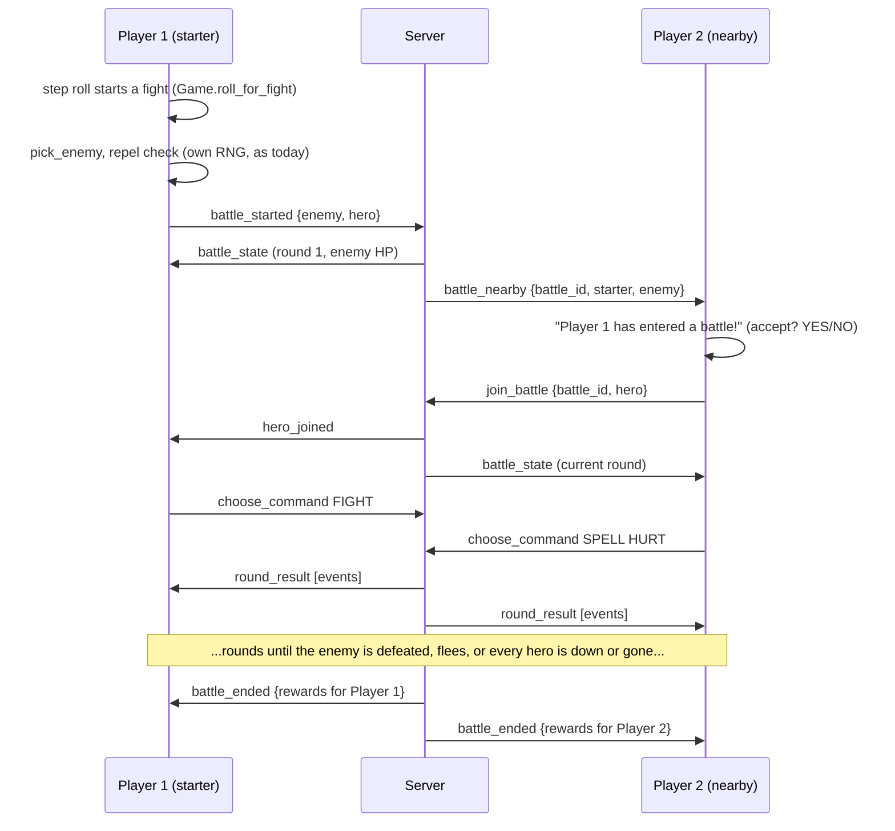

# Multiplayer design

A design for online co-op, written before any code. Part of
[#438](https://github.com/eforgacs-games/Dragon_Warrior/issues/438), which also asks about achievements; those
are out of scope here (see #438).

Contents:

1. [Summary](#1-summary)
2. [What is shared and what isn't](#2-what-is-shared-and-what-isnt)
3. [Hosting and networking](#3-hosting-and-networking)
4. [Presence: seeing each other on the map](#4-presence-seeing-each-other-on-the-map)
5. [Join-in battles](#5-join-in-battles)
6. [Prerequisite: battle rules without pygame](#6-prerequisite-battle-rules-without-pygame)
7. [Protocol sketch](#7-protocol-sketch)
8. [Edge cases](#8-edge-cases)
9. [Phased plan](#9-phased-plan)
10. [Open questions](#10-open-questions)

## 1. Summary

These points are decided:

- **Overlapping worlds, not a shared world.** Every player keeps their own save and their own story: their own
  Gwaelin, chests, doors, story flags and Dragonlord. Two things are shared: **presence** (players on the same map
  see each other) and **battles** (a player can join a nearby player's fight).
- **Multiplayer is opt-in.** With it off, nothing changes: single-player plays exactly as it does today, NES
  accuracy included.
- **Presence**: other players on the same map are drawn as palette-swapped heroes with their name. Movement is
  synced per tile step (16 frames), a few small messages a second, and each client slides the sprite between tiles.
- **Join-in battles**: when a player's random encounter starts a fight, nearby players (same map, within N tiles)
  get "Player 2 has entered a battle!" and a short window to join. The joining hero takes part in the fight.
- **Two-hero rounds**: each round every hero picks FIGHT, SPELL, ITEM or RUN, then the round plays out in agility
  order, with a turn timer.
- **Full rewards**: every hero gets the full EXP and gold. To balance it, the enemy's HP is scaled up per extra
  hero so a group fight lasts about as long as a solo one.
- **Self-hosted**: any player runs a small Python server; the others connect over a LAN or a virtual LAN. The
  server is authoritative for shared battles: it makes the random rolls.

## 2. What is shared and what isn't

| | Each player's own | Shared |
|---|---|---|
| Save file, level, stats, items, gold | yes | |
| Story flags, Gwaelin, chests, doors, map layout changes | yes | |
| Guardians (Golem, Green Dragon, Axe Knight) and the Dragonlord | yes | |
| NPCs, their positions and schedule | yes (each client runs its own) | |
| Random encounters (the step roll, which enemy) | yes | |
| Where the other heroes are on the same map | | yes |
| A battle someone else started nearby | | yes, if you join |

Other heroes are **ghosts** in your world: they don't block your hero or your NPCs, and they can walk through a door
that is still locked in your world (they opened it in theirs). That's the price of overlapping worlds and it keeps
everything else simple: no world state ever has to be merged.

```
   Player 1's game                       Player 2's game
 +--------------------+                +--------------------+
 | own save, story,   |                | own save, story,   |
 | NPCs, encounters   |                | NPCs, encounters   |
 |                    |                |                    |
 |  draws P2 as a     |<-- presence -->|  draws P1 as a     |
 |  ghost hero        |                |  ghost hero        |
 +---------+----------+                +----------+---------+
           |          shared battle only          |
           +----------------> server <------------+
                     (rolls the dice, sends results)
```

## 3. Hosting and networking

**Self-hosted.** The group is the owner and a handful of friends, so there is no central service. Any player runs:

```
uv run python -m src.server --port 8765 --secret <shared password>
```

The others connect to that machine's address. Over the internet, the recommended setup is a virtual LAN
(Tailscale, ZeroTier or Hamachi): every player joins the same private network and connects to the host's virtual
address. Nothing is exposed to the internet and no router port forwarding is needed. The same server can later run
unchanged on a small cloud VM if the group wants an always-on host.

**Stack**: `asyncio` and the `websockets` library, JSON messages. `websockets` becomes a dependency only when the
server is written (phase 2); the game must still start without it when multiplayer is off.

**Authority**:

- On the map, each client is the authority for its own hero. The server relays positions; it doesn't check them
  (there is nothing to win by teleporting a ghost).
- In a shared battle, the server is the authority. It holds the battle state and makes every random roll (enemy HP,
  damage, dodges, enemy spells, runs), so all players see the same result, and a modified client can't change a roll.
  Clients send only the command they chose.

**Client threading**: the game's loops block (a fight's dialog lines wait for frames and buttons inside
`CommandMenu.show_line_in_dialog_box`, `wait_frames` and friends), so the network client runs in a background thread
with its own asyncio loop and talks to the game through two `queue.Queue`s. The game polls the inbox once a frame on
the map and between battle events in a fight. Nothing in the game loop ever waits on the network.

```python
class NetworkClient:
    """Runs the websocket connection in a background thread; the game only touches the two queues."""

    def __init__(self, url: str, name: str, secret: str) -> None:
        self.inbox: queue.Queue[dict] = queue.Queue()
        self.outbox: queue.Queue[dict] = queue.Queue()
        self._thread = threading.Thread(target=asyncio.run, args=(self._run(url, name, secret),), daemon=True)

    def send(self, message: dict) -> None:
        self.outbox.put(message)

    def received(self) -> list[dict]:
        """Every message that has arrived since the last call (called once a frame)."""
        messages = []
        while not self.inbox.empty():
            messages.append(self.inbox.get_nowait())
        return messages
```

## 4. Presence: seeing each other on the map

### Movement sync

The hero walks one NES pixel a frame, so a step is 16 frames long (`NES_PIXELS_PER_TILE` and `STEP_SYNC_FRAMES` in
`src/movement.py`), or 8 frames with the RUN BUTTON option (`RUN_STEP_FRAMES`). A step only starts on a frame where
`FrameCounter & $0F` is 0. That gives a natural unit for syncing:

- When the local hero **starts** a step (`MovementController.move_player`), the client sends one `step` message:
  the map, the cell it leaves, the direction and the step's length in frames.
- A remote client draws the ghost sliding from the old cell to the new one over those frames, one NES pixel a frame,
  with the usual walking animation (the shared `AnimatedSprite.walk_frame`).
- A turn without a step (facing a new direction) is a `face` message.

At 1x a hero takes at most 60 / 16 = 3.75 steps a second (7.5 with RUN), so presence is a few messages a second per
player, each well under 100 bytes. If a message is late, the ghost finishes its slide and snaps to the latest cell;
nothing depends on it being exact.

### Drawing the ghost

The hero is drawn from PNG sprite sheets (`Directories.UNARMED_HERO_PATH`, `ARMED_HERO_PATH`,
`ARMED_HERO_WITH_SHIELD_PATH`, `UNARMED_HERO_WITH_SHIELD_PATH`, `HERO_CARRYING_PRINCESS_PATH`), scaled and split by
`DragonWarriorMap.scale_sprite_sheet` / `parse_animated_sprite_sheet`. For a ghost:

- The client loads the sheet that matches the other player's look (unarmed, armed, with shield, carrying Gwaelin;
  sent as `look` in the presence state) and recolors it: each of the sheet's few colors is mapped to the other
  player's palette (for example with `pygame.PixelArray.replace`). The server assigns each player a palette from a
  short fixed list when they connect, so colors stay consistent for everyone.
- The player's name (the save's name, up to 4 characters as in the pop-up window) is drawn in small text above the
  ghost.
- Ghosts are drawn with the other sprites (`Drawer.draw_all`), as a separate group, never in the map's
  `character_key`, so collisions, NPC movement and `save_state` snapshots don't see them.

### Which players you see

- Only players on the same map identifier. A map change (stairs, a warp, RETURN, Wings) sends `join_map`; the old
  map's clients drop the ghost.
- In dark dungeons, a ghost is drawn only inside your own lit area (the torch or RADIANT circle `Drawer.draw_darkness`
  leaves visible). Each player brings their own light; you don't see someone in the dark unless your light reaches
  them.

## 5. Join-in battles

### How a fight becomes shared



1. The encounter roll stays local and NES-exact: `Game.roll_for_fight` → `roll_encounter` → `pick_enemy`, then the
   repel check (`BattleController.is_repelled`). Each player's encounters come from their own world and their own
   RNG.
2. If multiplayer is on and another connected player is on the same map within **N tiles** (proposed N = 8, about half
   a screen), the fight is **hosted by the server** from its first roll: the client sends `battle_started` with the
   enemy name and its hero's battle stats. Otherwise it is a normal local fight, exactly as today.
3. Nearby players get `battle_nearby`. If they are standing on the map with no window open, they see "Player 1 has
   entered a battle!" and a YES/NO prompt. Joining is allowed **until the first round has been resolved**.
4. A joining hero starts in the next round. Their client plays the battle intro (the spiral, the enemy's fade-in)
   and shows the battle as it is now.

Scripted fights never broadcast (see [Edge cases](#8-edge-cases)).

### On screen

DQ1 never draws the hero in battle: `Battle.transition_battle_background_image_effect` hides him under the spiral, and
he stays hidden. So "the joining hero appears in the battle" means:

- A line when they join: "Player 2 joins the fight!".
- A second pop-up stats window for them, next to the local hero's (`Drawer.draw_hovering_stats_window` takes a
  `player`; it needs a position parameter and a smaller variant).
- Their actions in the dialog box, the same way the hero's are worded today ("Player 2 attacks!", "Player 2 chants
  the spell of HURT.").

### Rounds

Single-player DQ1 isn't round-based: the hero acts, then the enemy, with a first-strike roll at the start
(`player_acts_first`) and some special cases (the enemy acting twice after SLEEP, a sleeping hero's wake roll). That
flow stays exactly as it is for solo fights. **Only fights with two or more heroes use rounds.**

The party round borrows its shape from Dragon Quest II, where the whole party picks commands and then everyone acts
in an order based on agility. This is an inspiration, not a port: the formulas below are this project's own.

1. **Choose**: every standing hero picks FIGHT, SPELL (and which spell), ITEM (and which item) or RUN. Each client
   shows its own command window; the server waits for all commands or the turn timer.
2. **Order**: every hero and the enemy get an order roll. A hero's is `agility * random_byte()`. The enemy's
   Agi byte is not an agility on the NES (`Enemy.speed` holds sleep and STOPSPELL resistances), so the enemy uses its
   defense, as the NES does when it compares the enemy with the hero for the first strike and for running
   (`player_acts_first`, `can_run_away`): `defense * (random_byte() & 0x3F)`. Highest acts first.
3. **Resolve**: each actor acts in that order with the existing rules (`player_hit_damage`, `enemy_dodges`,
   `calculate_enemy_attack_damage`, the spell routines, the enemy's spell pattern). A hero who is down or gone is
   skipped. The battle ends the moment the enemy's HP reaches 0 or the enemy flees.
4. **Show**: the server sends the round as a list of events; each client plays them with the usual text, sounds and
   flashes, then sends `round_shown`. The next round starts when every client has shown it (or after a timeout, so
   one slow client doesn't stall the others).

Enemy targeting: the enemy picks one standing hero at random for each attack or spell (HURT, SLEEP, STOPSPELL, fire
breath). `enemy_flees` (CheckEnRun) uses the highest strength among the standing heroes: a party with one strong hero
scares a weak enemy as much as that hero alone would.

**Turn timer**: proposed 20 seconds. A hero with no command when it runs out does FIGHT, the same default the
auto-battle option (F4) lands on when its last command was FIGHT. A short on-screen countdown is drawn in the command
window's corner.

### Rewards and enemy HP

Every hero gets the full EXP and gold, since each one has their own save. Without balancing, two heroes would kill
everything in half the time and take half the hits each, so group fights would be a free double reward.

The enemy's starting HP is scaled per extra hero:

```
starting_hp = randomize_enemy_hp(enemy) * hp_multiplier(hero_count)
hp_multiplier(n) = 1 + 0.75 * (n - 1)          # 1.0, 1.75, 2.5, 3.25 ...
```

Reasoning:

- Damage per round grows about linearly with the number of heroes, so a multiplier near 2 for two heroes keeps the
  number of rounds about the same.
- It is a bit under 2 on purpose: the joining hero comes in from round 2, the two heroes are often at different
  levels, and the enemy still only acts once a round, so its pressure is split between two heroes. A slightly
  shorter fight with half the damage per hero is still a fair trade for a full reward.
- The multiplier is applied when a hero joins (the enemy's current and maximum HP both scale by
  `hp_multiplier(n) / hp_multiplier(n - 1)`), not at the start, since the starter doesn't know yet whether anyone
  will join.
- The enemy's HEAL and HEALMORE are capped at its maximum HP (`Enemy.recover_hp`); that maximum is scaled too.
- The multiplier is a server setting, so the group can tune it after playing.

Gold: the server rolls `randomize_enemy_gold` once per hero, so each gets an NES-style drop. Each client then applies
its own EXP/GOLD option (`exp_gold_multiplier`), the 65535 caps, and the level-up flow (`Battle.check_player_level_up`)
in its own game.

## 6. Prerequisite: battle rules without pygame

The server has to run the battle rules headless. Today they are tangled with drawing, sound, text and input. Some of
the rules are already pure functions and can be reused as they are:

- `src/battle.py`: `randomize_enemy_hp`, `randomize_enemy_gold`, `can_run_away`, `normal_attack_damage`,
  `is_excellent_move`, `excellent_move_damage`, `player_hit_damage`, `calculate_enemy_attack_damage`, `enemy_dodges`,
  `enemy_flees`, `player_acts_first`, `exp_gold_multiplier`.
- `src/encounters.py` (the whole module), `src/nes_random.py`, `src/enemy_spells.py`, `src/enemy.py`,
  `src/player/player_stats.py`.

### Where logic and pygame are mixed today

| File: function | What it mixes |
|---|---|
| `battle.py`: `Battle.__init__` | the enemy and its HP roll, together with `Sound`, `Directories`, `Graphics` and gettext |
| `battle.py`: `Battle.battle_run` | the run roll with SFX_RUN, the dialog lines, and the enemy's turn (through `cmd_menu.game.battle_ctrl.enemy_move`) |
| `battle.py`: `Battle.calculate_attack_damage` | the excellent-move roll and damage with its sound and line |
| `battle.py`: `Battle.enemy_defeated`, `check_player_level_up`, `display_stat_increases` | EXP, gold and the level-up stat changes with the victory and level-up music, the lines and button waits |
| `battle_controller.py`: `BattleController.fight_enemy` | the battle loop, outcome and story flags (`record_victory`) with music, the battle window and the map reload |
| `battle_controller.py`: `start_fight` | the flee and first-strike rolls with the "attacked before ... was ready" line and the low-HP palette |
| `battle_controller.py`: `handle_battle_prompts` | input reading, the turn flow (the `no_op` flag decides whether the enemy moves), and the command window |
| `battle_controller.py`: `hero_attack` | the dodge roll and HP change with sounds, `Drawer.flash_enemy` and text |
| `battle_controller.py`: `enemy_move`, `enemy_turn`, `execute_enemy_pattern`, `enemy_attack`, `execute_enemy_attack` | the enemy AI, its spell rolls and effects with lines, sounds, `Drawer.flash_enemy_spell` and `Game.receive_damage` |
| `battle_controller.py`: `sleeping_player_turn`, `enemy_run_away` | wake and flee results with lines, sounds and button waits |
| `game.py`: `Game.receive_damage` | the hero's HP change with the hit sound, screen shake, window palette and the damage line |
| `menu.py`: `CommandMenu.cast_damage_spell`, `sleep`, `stopspell`, `battle_spell_resisted`, `use_item_in_battle`, `herb` and the other battle items | the hero's spell and item effects and their rolls, inside the menu class, with text and flashes; they end turns by setting `current_battle.no_op` |

### Target split

```
src/battle_rules/                       (no pygame imports)
    state.py      BattleState, HeroState, EnemyState  (plain dataclasses)
    commands.py   Fight, CastSpell(spell), UseItem(item), Run
    events.py     HeroAttacked, ExcellentMove, EnemyDamaged, Missed, Dodged,
                  EnemyChanted(spell), SpellBlocked, SpellResisted, HeroDamaged,
                  HeroFellAsleep, HeroWoke, EnemyFled, HeroRanAway, Blocked,
                  EnemyDefeated, HeroDown, Rewards ...
    solo.py       the NES flow for one hero: hero turn, enemy turn, first strike,
                  the sleep chains; exactly today's behavior
    party.py      the round model for 2+ heroes (section 5)

src/battle_view.py  (client) turns events into what the game does today:
                    show_line_in_dialog_box with the same waits, sounds,
                    flash_enemy, player_hit_shake, the stats window
```

The rules take the state, the command(s) and a source of random numbers, change the state and return events:

```python
def hero_fights(state: BattleState, hero: HeroState, rng: RandomSource) -> list[BattleEvent]:
    """NES PlyrFight: an excellent move 1 time in 32 (never against the Dragonlord), else a normal hit; then the
    enemy's dodge roll (SetEnDmg1), which a sleeping enemy never gets."""
    events: list[BattleEvent] = [HeroAttacked(hero.name)]
    enemy = state.enemy
    if enemy.name not in DRAGONLORD_FORMS and is_excellent_move(rng.randint(0, 255)):
        events.append(ExcellentMove(hero.name))
        damage = excellent_move_damage(hero.attack_power, rng.randint(0, 255))
    else:
        damage = player_hit_damage(hero.attack_power, enemy.defense)
    if damage <= 0:
        events.append(Missed(hero.name))
    elif not enemy.is_asleep and enemy_dodges(enemy.dodge, rng.randint(0, 255)):
        events.append(Dodged(enemy.name))
    else:
        enemy.hp -= damage
        events.append(EnemyDamaged(enemy.name, damage))
    return events
```

Rules for the refactor:

- **Same random calls, same order.** Single-player passes the `random` module as `rng`, so seeded runs, the
  `random` state in save states (`save_state.take_snapshot` stores `random.getstate()`), and the tests that patch
  `random.randint` all see exactly the calls they see now. The server passes its own `random.Random` per battle.
  (`player_hit_damage` and `nes_random.coin_flip` call the module's `random` directly; they get an `rng` parameter
  that defaults to it.)
- **Same text and timing.** The view keeps every line's wording and wait (`BATTLE_LINE`, the WAITs the docstrings
  describe). The current battle tests (`tests/test_battle.py`, `test_battle_controller.py`,
  `test_battle_text_waits.py`, ...) are the safety net: they should pass unchanged.
- **The `no_op` flag goes away.** Whether a command took the turn becomes part of the rule's result (for example a
  `TurnTaken` / `NoTurn` return value), not a flag the menu sets on the battle.
- **Spell and item effects move out of `CommandMenu`.** The menu still shows the SPELL and ITEM windows; it returns
  the choice, and the rules apply it.

This pays off for single-player too: battles can be tested as data (state in, events out) without a screen,
and a long run of seeded fights can check the NES formulas quickly.

## 7. Protocol sketch

JSON over websockets, one message per frame, each with a `type`. Every message from the client may carry an `id`
the server echoes in its reply or error.

### Versioning

The first message is `hello` with `protocol` (an integer, starting at 1) and the game's `version`. The server answers
`welcome` or `error {"reason": "protocol"}` and closes. A new message type or field that old clients can ignore keeps
the number; anything that changes the meaning of an existing message bumps it. Shared battles also need both sides to
run the same rules, so the server also refuses a client whose `rules` version (bumped whenever a battle formula
changes) differs from its own.

### Messages

| Type | From | Contents | When |
|---|---|---|---|
| `hello` | client | `protocol`, `version`, `rules`, `name`, `secret` | on connect |
| `welcome` | server | `player_id`, `palette`, the players online | reply to `hello` |
| `error` | server | `reason`, `id` | a refused message, a bad secret, a version mismatch |
| `join_map` | client | `map`, `cell`, `direction`, `look` | on connect and after every map change |
| `players` | server | for each player on your map: `player_id`, `name`, `palette`, `cell`, `direction`, `look` | after your `join_map`, and to the others on that map |
| `step` | client → server → clients | `player_id`, `from_cell`, `direction`, `frames` (16 or 8) | each step the hero starts |
| `face` | client → server → clients | `player_id`, `direction` | a turn without a step |
| `look` | client → server → clients | `player_id`, `look` (unarmed, armed, shield, carrying) | equipment changes, picking up Gwaelin |
| `leave` | client | | quitting multiplayer; the server tells the map with `player_left` |
| `battle_started` | client | `enemy`, `hero` (battle stats) | a random fight with someone within N tiles |
| `battle_state` | server | `battle_id`, `round`, `enemy` (name, HP shown as the NES shows it: not at all), the heroes' pop-up values | after `battle_started` or `join_battle` |
| `battle_nearby` | server | `battle_id`, `starter`, `enemy`, `join_until_round` | to players within N tiles |
| `join_battle` | client | `battle_id`, `hero` | the player said YES |
| `hero_joined` | server | `battle_id`, the hero's name and pop-up values | to everyone in the battle |
| `choose_command` | client | `battle_id`, `round`, `command` (`fight`, `spell`+`spell`, `item`+`item`, `run`) | once a round |
| `round_result` | server | `battle_id`, `round`, `events` (the event list from section 6, as dicts) | when every command is in, or the timer ran out |
| `round_shown` | client | `battle_id`, `round` | the client has played the round's events |
| `battle_ended` | server | `battle_id`, `outcome` for this hero (victory, defeat, escaped), `hp`, `mp`, `items_used`, `experience`, `gold` | the end, per hero |
| `disconnect` | server | `player_id`, `battle_id` if any | a player's connection dropped |
| (keepalive) | both | | websockets' built-in ping every few seconds; a missed pong counts as a disconnect |

The hero's battle stats are what the rules need: `name`, `level`, `current_hp`, `max_hp`, `current_mp`, `strength`,
`agility`, `attack_power`, `defense_power`, `armor`, `spells`, the battle items it carries, and its statuses. The
server checks them against the level tables (`get_stats_for_level`) and the equipment tables, and refuses impossible
values. It can't check a save file it has never seen; among friends that's fine.

Example:

```json
{"type": "step", "player_id": 2, "from_cell": [43, 43], "direction": "down", "frames": 16}
{"type": "choose_command", "battle_id": 7, "round": 3, "command": "spell", "spell": "HURT"}
{"type": "round_result", "battle_id": 7, "round": 3, "events": [
  {"event": "hero_attacked", "hero": "ERDK"},
  {"event": "enemy_damaged", "enemy": "Skeleton", "damage": 9},
  {"event": "enemy_chanted", "enemy": "Skeleton", "spell": "HURT"},
  {"event": "hero_damaged", "hero": "LOTO", "damage": 7}
]}
```

### Rates

- Presence: up to about 4 `step`s a second per player at 1x (8 with RUN), sent only to players on the same map.
- Battles: a handful of messages a round.
- The keepalive ping every few seconds.

Even with a handful of players this is a few kilobytes a second at most.

## 8. Edge cases

| Case | Behavior |
|---|---|
| **A player disconnects mid-battle** | For the others, the hero stays in for the rest of the fight and does FIGHT every round (as on a timer timeout), so the fight doesn't suddenly get harder or easier. On the disconnected player's side, the client says the connection was lost and ends the fight as an escape, keeping the HP, MP and items from the last round it received, with no reward. If nobody is left connected, the server drops the battle. |
| **A player dies in a group fight** | Their hero is down until the end of the fight: no commands, the enemy doesn't target them, their pop-up window turns to the low-HP color with 0 HP. If the party wins, the downed hero gets no EXP or gold. Once the fight ends, their game runs the normal death rules in their own world (`Game.handle_death`: the death music, "Thou art dead.", back to King Lorik with half the gold). If everyone is down, it's a defeat for all. |
| **Different levels** | No scaling by level for now. The enemy comes from the starter's encounter zone, so a strong helper makes an easy fight easier and a weak helper is in danger; both choose to join. The HP multiplier is per hero, not per level. Revisit after playtesting. |
| **Running away** | RUN is per hero: the hero who runs uses the NES run check (`can_run_away` with their own agility; always works against a sleeping enemy) and, on success, leaves the fight with no reward; their client returns to the map as after a normal run. The others keep fighting. The enemy's HP is not scaled back down. When the last hero runs, the fight is over. |
| **Scripted, guardian and Dragonlord fights** | Single-player only: `BattleController.start_scripted_battle` (the Golem, the Green Dragon, the Axe Knight, the Dragonlord, `Dragonlord 2`) never sends `battle_started`, so nobody can join. These fights carry story flags (`record_victory`), the run-back rules (`step_back_after_running`) and the ending. |
| **REPEL and Fairy Water** | Checked by the starter's client before the fight exists (`is_repelled`), as today. A repelled enemy is never broadcast. |
| **Encounters option** | ENCOUNTERS OFF/HALF (`Game.thin_encounters`) only affects your own encounters. You can still join others' fights. |
| **Map changes** | Leaving the map removes your ghost there. A player who changes map can't be offered a join (`battle_nearby` is sent only to players on the battle's map). |
| **Dark dungeons** | Ghosts are drawn only inside your own light (section 4). Join offers still go to players within N tiles, lit or not; the message says who is fighting. |
| **Save states and rewind** | Disabled while online. Rewinding (`src/rewind.py`) or loading a save state (`src/save_state.py`) would move your hero, undo fights others saw, or restore the HP you lost in a shared battle. Normal saving at King Lorik is fine. |
| **Game speed** | Fixed at 1x while online (the speed keys in `src/waiting.py` are ignored). Presence assumes 16-frame steps, and shared battle text has to play at a pace everyone can follow. |
| **Auto-grind** | Off while online (`src/auto_grind.py` can't answer join offers or shared command windows). The F4 auto-battle still works in shared fights: it answers the command window with your last command. |
| **Pause** | Pausing on the map is local: others see your hero standing still. A shared battle has no pause; the turn timer keeps running. |
| **Being offered a join while busy** | No offer is shown while a window is open, a dialog is running, you're in a shop or in your own fight. The offer just expires. |
| **Same name twice** | The server refuses a second connection with a name already online. |
| **Remote HP visible?** | Only in a shared fight, through the pop-up window. On the map, you see a ghost, not stats. |

## 9. Phased plan

### Phase 1: battle rules refactor (the biggest phase)

Single-player only; no networking. Move the rules into `src/battle_rules/` (section 6), make
`BattleController` and `Battle` drive the rules and render the events, move the battle spell and item effects out of
`CommandMenu`, remove `no_op`.

Tests:

- The existing battle tests pass unchanged (same text, same waits, same random calls).
- New headless tests: battles as data, with a seeded `random.Random`, no display. For example: a hundred seeded
  Slime fights at level 1 give the same outcomes before and after the refactor; HURT never does damage outside
  5-12; the enemy's SLEEP chain gives the enemy a second turn.
- A first `party.py` with tests for the round order and the HP multiplier, still offline.

### Phase 2: server and presence

`src/server.py` (asyncio + websockets): `hello`/`welcome` with the shared secret, maps, `step`/`face`/`look`, `leave`,
keepalive. Client: `NetworkClient` thread, an options entry to turn multiplayer on (address, name, password), ghost heroes
drawn with palettes and names, rewind and save states off while online, speed fixed at 1x.

Tests:

- Server tests that start it on a free local port and connect two plain websocket test clients (`asyncio.run` in
  the test, no extra plugin needed): auth, wrong secret, protocol mismatch, map filtering, disconnect.
- A **local two-client harness**: a script that starts the server and two games on one machine, each with its own
  save folder and a checkpoint (`--checkpoint`), for example both at `rainbow_bridge`. Manual checks: the ghost
  slides smoothly, stairs remove it, darkness hides it.
- A bot client (a small script) that walks a fixed path, for testing presence without a second person.

### Phase 3: join-in battles

`battle_started` / `battle_nearby` / `join_battle`, the server running `party.py` with its own `random.Random`, the
round flow and turn timer, the second pop-up window, rewards and the HP multiplier, disconnects and deaths.

Tests:

- Headless server battle tests with scripted clients: two heroes, a seeded server, the expected `round_result`s; a
  disconnect mid-fight; a death; a run; the last hero running; a join after round 1 (refused).
- The two-client harness again, with `--dev`'s F6 to set levels, for a few real fights.

### Phase 4: extras

Small and independent, in any order:

- Emotes or quick chat (a few fixed phrases over a ghost's head).
- Trading items or gold between two players standing next to each other (both confirm; the server just relays).
- A "help" flare: a player in a fight can send a call that shows on the overworld for everyone on the map, so a
  friend further than N tiles away knows where to go.

## 10. Open questions

1. **N tiles**: is 8 (about half a screen) the right radius for join offers?
2. **HP multiplier**: start at 1.75 per extra hero, or 2.0? Should the enemy also act twice a round with 3+ heroes?
3. **Joining window**: until the end of round 1, or a fixed number of seconds?
4. **Turn timer**: 20 seconds? And does the timeout pick FIGHT, or the hero's last command?
5. **HEAL on a friend**: NES HEAL and HEALMORE only heal the caster. Should party fights let them target the other
   hero (and the Herb)? It changes the feel a lot.
6. **EXP/GOLD option**: should each player's own EXP/GOLD multiplier apply to shared rewards, or should the server
   force 1x?
7. **Downed hero and rewards**: should a hero who was knocked out still get the EXP if the party wins?
8. **Disconnects**: keep the disconnected hero fighting automatically, or remove it at once?
9. **Running**: should the enemy's HP scale back down when a hero runs, to keep the fight fair for the one left?
10. **Names**: the save's name (4 characters on the NES pop-up) or a separate online name?
11. **Versus**: #438 mentions co-op "and/or versus". This design is co-op only. Is versus wanted at all?
12. **Achievements**: out of scope here; see #438.
